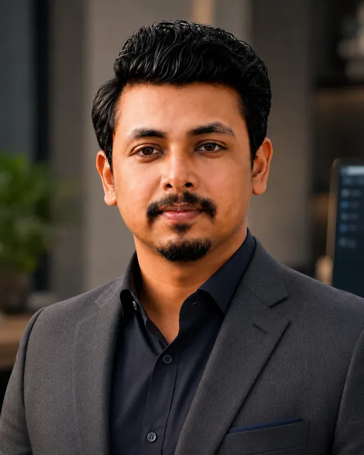

<p align="center">
  
</p>

<h1 align="center">Rahad Arefin</h1>

<p align="center">
  <strong>Growth Marketing Leader · Performance Marketing · Marketing Technology · AI Automation</strong><br>
  Dhaka, Bangladesh · Open to Head of Digital and Senior Growth roles, remote or relocation
</p>

<p align="center">
  <a href="https://rahadarefin.com">Portfolio</a> ·
  <a href="https://linkedin.com/in/rahad-arefin">LinkedIn</a> ·
  <a href="https://rahadarefin.com/#insights">Insights</a> ·
  <a href="https://rahadarefin.com/#work">Case studies</a> ·
  <a href="Rahad_Arefin_Resume.pdf">Resume (PDF)</a>
</p>

---

## Who is Rahad Arefin?

**Rahad Arefin is a growth marketing leader based in Dhaka, Bangladesh, with 8+ years of experience building revenue engines for brands across the USA, Canada, the United Kingdom, Australia and Bangladesh.** He has managed **$2.9M+ in ad spend** that drove **$24M+ in attributed revenue** at a **4.7x average ROAS**, worked across **150+ client accounts**, and leads a **24-member team** across PPC, SEO, paid social, creative and content.

He owns the full growth function: digital marketing strategy, budget and media mix, customer acquisition, funnel and conversion rate optimization (CRO), marketing technology, and the team that executes it. He is known for judging marketing on pipeline and revenue rather than vanity metrics, for using AI and automation to remove manual work, and for advising CEOs on growth problems beyond marketing.

This repository contains the source code of his personal portfolio website, **[rahadarefin.com](https://rahadarefin.com)**.

## Quick facts

| | |
| --- | --- |
| **Name** | Rahad Arefin |
| **Profession** | Growth marketing leader, digital marketing manager |
| **Current role** | Digital Marketing Manager, Sylvex Innovation (Sydney, Australia, remote) |
| **Based in** | Dhaka, Bangladesh |
| **Markets** | USA, Canada, United Kingdom, Australia, Bangladesh |
| **Experience** | 8+ years (since 2018) |
| **Ad spend managed** | $2.9M+ |
| **Attributed revenue** | $24M+ (8.3x revenue on ad spend) |
| **Average ROAS** | 4.7x |
| **Accounts** | 150+ in total, 17+ run in parallel |
| **Team** | 24 people across PPC, SEO, paid social, creative and content |
| **Education** | M.Sc. and B.Sc. in Computer Science and Engineering |
| **Open to** | Head of Digital, Senior Growth Manager and senior growth leadership roles |
| **Website** | [rahadarefin.com](https://rahadarefin.com) |
| **LinkedIn** | [linkedin.com/in/rahad-arefin](https://linkedin.com/in/rahad-arefin) |

## Key achievements

- **$24M+ attributed revenue from $2.9M+ ad spend**, a nearly 8x return, across 150+ accounts in five countries.
- **Grew one client from a single business to 14 business units in 3 years** by taking ownership of operations, SOPs, sales monitoring and hiring alongside marketing.
- **+210% purchases and 1.6x more conversions per ad dollar (38% lower CPA)** for a global eCommerce brand through full-funnel restructuring.
- **+71% revenue per visitor** by lifting conversion rate 45% and average order value 18% through CRO.
- **30% of manual workflows removed** with AI automation, including a zero-cost AI reporting pipeline for Google Ads and Meta Ads.
- **Built and leads a 24-member cross-functional team** on process-first systems, and won 7 new clients through his own network.

## Experience

### Sylvex Innovation · Digital Marketing Manager
*Sydney, NSW, Australia (remote) · 2021 to present*

- Leads a 24-member team across PPC, SEO, paid social, creative and content.
- Owns a $440K+ annual paid media budget at 4.7x ROAS.
- Manages 17+ ad accounts in parallel for businesses in the USA, Canada, UK, Australia and Bangladesh.
- Scaled one client from a single brand to 14 business units within 3 years.
- Authored the go-to-market strategy and paid acquisition test plan for a four-service product relaunch.
- Built cohort-based reporting that moved leadership decisions from cost per lead to cost per sales-accepted lead (SAL) and booked meeting.

### Arison Holdings Limited · Senior Business Development Officer (IT) and Digital Marketing Specialist
*Dhaka, Bangladesh · 2020 to 2022*

- Led product teams to launch 3 new product lines, adding 12,000 customers and 9% revenue.
- Grew revenue 13% and raised ROI 15% by closing process gaps.

### Orange Business Development · Business Analyst (IT)
*Dhaka, Bangladesh · 2018 to 2019*

- Improved marketing ROI 20% through data-driven reporting.
- Cut manual effort 30% by automating HubSpot workflows.

## Expertise

**Leadership and strategy:** digital marketing strategy, growth strategy, go-to-market (GTM), budget management, media mix planning, team leadership, cross-functional leadership, stakeholder management, KPI frameworks.

**Performance marketing and acquisition:** paid media, PPC, SEM, paid social, Google Ads (Search, Performance Max, Demand Gen, Shopping, YouTube), Meta Ads (Facebook and Instagram), TikTok Ads, LinkedIn Ads, Microsoft Advertising, media buying, customer acquisition, lead generation, retargeting.

**Marketing technology and analytics:** Google Analytics 4 (GA4), Google Tag Manager (GTM), server-side tracking, Conversions API (CAPI), attribution, HubSpot, GoHighLevel, CRM, Microsoft Clarity, Google Search Console.

**SEO and content:** search engine optimization, technical SEO, keyword research, SEMrush, content marketing, social media marketing, email marketing.

**AI and automation:** marketing automation, AI agent workflows, Claude, LLM APIs, n8n, Zapier, Google Ads Scripts, automated reporting.

**Growth and customer experience:** conversion rate optimization, A/B testing, funnel optimization, lifecycle and retention marketing, brand positioning, pricing and promotions.

## Selected case studies

| Client | Result | Channels |
| --- | --- | --- |
| Multi-location restaurant group (USA) | 5.3x ROAS, +190% online orders in 60 days | Performance Max, Meta DPA, local SEO |
| Premium interior firm (Bangladesh) | BDT 1.13 Crore revenue and 273 verified leads in 4 months | Meta and TikTok video funnel |
| Global SaaS startup | $18 cost per lead at 3.2x ROAS, 4 new markets in 3 months | LinkedIn Ads, Google Search, HubSpot |
| Global eCommerce brand | +210% purchases, 4.7x ROAS, 38% lower CPA | Google Shopping, Meta DPA, CRO |
| Grocery eCommerce (USA) | 4.1x ROAS, CTR from 1.3% to 3.9% | Google Shopping, Meta retargeting |
| FMCG brand launch (Bangladesh) | +148% online orders in 60 days, 3.6x blended ROAS | Meta Ads, retail partnerships, RFM |
| Supermarket chain (USA) | 3.8x ROAS, +62% repeat customers, +11% AOV | Geo-fencing, Facebook carousel, CRO |
| Shuttle service (Canada) | +190% bookings, 42% lower drop-off | Google Search, Meta, mobile UX |
| Study abroad agency | 338 verified leads, 72 university applications | Google PPC, Meta, lead scoring |
| Tourism operator | $4,136 revenue from $870 ad spend, 29 bookings | High-intent targeting |
| NGO donation campaign | 907 micro-donations, 17,000+ clicks in 3 weeks | Meta, Google Display, geo-targeting |

Full context, challenges and approach for each: [rahadarefin.com/#work](https://rahadarefin.com/#work)

## Insights: frameworks by Rahad Arefin

Practical playbooks from real accounts, published on his website:

1. **[The first 90 days as Head of Digital: a practical playbook](https://rahadarefin.com/insights/first-90-days-head-of-digital.html)**: listen and audit, deliver quick wins, then build the operating system, and what to avoid in month one.
2. **[Stop judging paid media by CPL: the cost-per-SAL framework](https://rahadarefin.com/insights/cost-per-sal-framework.html)**: pipeline metrics, 4- and 13-week lead cohorts, and the CRM counting trap.
3. **[How I audit a Google Ads account in 90 minutes](https://rahadarefin.com/insights/google-ads-audit-90-minutes.html)**: conversion tracking, structure, search terms, ads, landing pages, bidding and a one-page summary.
4. **[The 80/20 budget rule: how to scale paid media without gambling](https://rahadarefin.com/insights/80-20-paid-media-budget-rule.html)**: about 80% behind proven campaigns, about 20% for structured tests.
5. **[How I built a zero-cost AI reporting pipeline for Google Ads and Meta Ads](https://rahadarefin.com/insights/zero-cost-ai-reporting-pipeline.html)**: Google Ads Scripts, one Google Sheet, Meta's connector and Claude, with no paid connector.

## Free tools

- **[Growth Health Check](https://rahadarefin.com/#tools)**: eight questions that score a marketing program out of 100 and show its three biggest gaps.
- **[ROAS calculator](https://rahadarefin.com/#tools)**: compares current return on ad spend with a 4.7x benchmark.

## Education and certifications

- **M.Sc. in Computer Science and Engineering**, Jahangirnagar University, 2024
- **B.Sc. in Computer Science and Engineering**, Bangladesh Army International University of Science and Technology (BAIUST), 2020
- Advanced Social Media Strategies and SEO Performance Analytics, HubSpot Academy (2025)
- Microsoft Advertising Certified Professional, Microsoft (2021)
- UX Design Professional Certificate and Digital Marketing and E-commerce Certificate, Google (2021)
- Facebook Blueprint Business Manager Certification, Meta (2020)

## Frequently asked questions

**Who is Rahad Arefin?**
Rahad Arefin is a growth marketing leader based in Dhaka, Bangladesh, with 8+ years of experience across the USA, Canada, the UK, Australia and Bangladesh. He has managed $2.9M+ in ad spend that drove $24M+ in attributed revenue, and he leads a 24-member team across PPC, SEO, paid social, creative and content.

**What roles is Rahad Arefin open to?**
Head of Digital, Senior Growth Manager and other senior growth marketing leadership roles, either remote or with relocation. He also takes on a small number of strategic consulting engagements such as audits, growth plans and paid media turnarounds.

**What results has Rahad Arefin delivered?**
A 4.7x average ROAS, 1.6x more conversions per ad dollar (38% lower CPA), +71% revenue per visitor from conversion rate and AOV gains, and growth of one client from a single business to 14 business units in 3 years.

**Which marketing channels and tools does he specialize in?**
Google Ads, Meta Ads, TikTok Ads, LinkedIn Ads and Microsoft Advertising, supported by GA4, Google Tag Manager, server-side tracking, Conversions API, HubSpot and GoHighLevel, with automation through Claude, LLM APIs, n8n, Zapier and Google Ads Scripts.

**Which industries has he worked in?**
eCommerce and retail, restaurants, grocery and FMCG, real estate, hospitality and travel, B2B SaaS and services, education, and nonprofits.

**How can I contact Rahad Arefin?**
Through the [contact section of his website](https://rahadarefin.com/#contact) or on [LinkedIn](https://linkedin.com/in/rahad-arefin).

---

## About this repository

The website is built with plain HTML, CSS and JavaScript, with no framework, no build step and no third-party scripts, so it loads fast and scores 100 for SEO and accessibility in Google Lighthouse. It is hosted on Hostinger at [rahadarefin.com](https://rahadarefin.com) and deploys automatically from the `main` branch.

```
index.html                 Homepage: portfolio, case studies, tools, FAQ
insights/                  Five articles, each with its own share image
404.html                   Custom not-found page
rahad.webp                 Headshot
og-image.jpg               Link preview image
Rahad_Arefin_Resume.pdf    Resume
robots.txt, sitemap.xml    Search engine files
.htaccess                  HTTPS, redirects, security headers and caching
vercel.json                Redirects the old portfolio address to rahadarefin.com
```

Settings such as the booking link and testimonials live in the `CONFIG` block near the bottom of `index.html`.

Icons from [Lucide](https://lucide.dev) (ISC License). Flags from [flag-icons](https://github.com/lipis/flag-icons) (MIT License).

<p align="center"><sub>© 2026 Rahad Arefin · <a href="https://rahadarefin.com">rahadarefin.com</a></sub></p>
